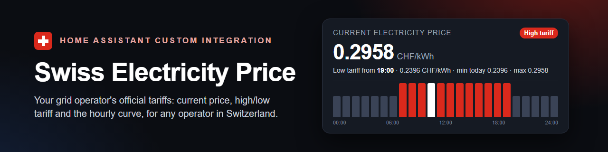

# Swiss Electricity Price (ElCom)



[](https://hacs.xyz/docs/marketplace/)
[](LICENSE)
<a href="https://www.buymeacoffee.com/prusuino"></a>

A Home Assistant custom integration that works with **any Swiss electricity grid operator**, based on the legally mandated "machine-readable tariffs" data file (ElCom/StromVV requirement).

## Background

Every Swiss electricity distribution grid operator (Verteilnetzbetreiber) is legally required (Art. 7b para. 1 StromVV) to publish a machine-readable JSON file listing all their current tariffs each year, and to report the download link to the Swiss Federal Electricity Commission (ElCom) annually. ElCom publishes this registry as open government data.

This integration queries ElCom's official registry directly to find each operator's reported tariff file link. In practice, not every one of the ~600 registered operators reports a link that resolves cleanly: some report a stable direct link to the JSON file, others only a general company web page (from which the actual file, if published there at all, has to be auto-discovered). This is a data-quality gap in ElCom's own registry, not a limitation of this integration — so during setup, every operator in the picker is labeled with a **direct link** or **auto-detect** hint, so you know what to expect before choosing.

## What it provides

All entities are created dynamically from the selected operator's own live JSON — no product, municipality, or operator names are hardcoded. Product names (e.g. "Basis Energie") and municipality names are the operator's own official names and are never translated.

| Entity | Description |
|---|---|
| `sensor.elcom_<operator>_<id>_energy_<product>` / `..._grid_<product>` | All energy and grid tariff products the operator publishes. State = the Rp/kWh rate active right now, with automatic high/low tariff switching by weekday + time where applicable — the state changes at the minute a tariff window starts or ends (e.g. 22:00 and 06:00). Attribute `schedule` lists all time windows. |
| `..._energy_<product>_high` / `_low` (likewise for `grid`) | Fixed high-tariff / low-tariff reference price for each product, independent of the current time. Only created for products with more than one price level. |
| `..._energy_<product>_base_fee` / `..._grid_<product>_base_fee` | Monthly base fee of the product (CHF/month, or the unit the operator's file names). Only created for products with a base price above 0. Only the energy and grid product chosen at setup are enabled; the others are created disabled and can be enabled in their entity settings. |
| `sensor.elcom_<operator>_<id>_metering_<type>` | Metering fees (CHF/month, flat rate), if published. |
| `sensor.elcom_<operator>_<id>_municipality_levy_<municipality>` | Municipal surcharge (Rp/kWh) for each municipality the operator serves. Only the municipality chosen at setup is enabled; the others are created disabled and can be enabled in their entity settings (all are enabled for an entry without a municipality). |
| `sensor.elcom_<operator>_<id>_tariff_level` | Whether **your configured energy tariff** is currently on high or low tariff. Attributes `next_change` and `next_level` tell when the level changes next and to what. |
| `binary_sensor.elcom_<operator>_<id>_high_tariff` | On while your configured energy tariff is on its high rate — the handier form of the tariff-level sensor for automation conditions and conditional cards. Only created for tariffs with more than one level. Same `next_change` / `next_level` attributes. |
| `calendar.elcom_<operator>_<id>_tariff` | Every stretch of high or low tariff of your configured energy tariff as a calendar event (summary = level, description = combined price). Known for any date, since Swiss tariffs are time-of-use schedules; works with calendar triggers and the calendar card. Only created for tariffs with more than one level. |
| `sensor.elcom_<operator>_<id>_price_next_period` | Combined price under the operator's **next tariff period** (next year's tariffs, published months ahead), evaluated at this very moment so it compares directly with `price_current`. Attributes: `valid_from`, `price_high` / `price_low` of the next period, `current_price_high` / `current_price_low`, `change_high_percent` / `change_low_percent`. Unavailable while the file holds no upcoming set. A notification is sent once when an upcoming period first appears. |
| `sensor.elcom_<operator>_<id>_price_current` | Combined current price for your configured municipality + energy/grid tariff products, including national levies and VAT, at the rates active right now. Attribute `calculation` spells out the full calculation in plain text. Attributes `raw_today` and `raw_tomorrow` hold the price for every hour of today and tomorrow (`start`, `end`, `value` in CHF/kWh), with `min_today`, `max_today`, `avg_today`, `price_next_hour`, and `next_change` / `next_price` / `next_level` for the next tariff switch — see [Dashboard examples](#dashboard-examples). |
| `sensor.elcom_<operator>_<id>_price_high` / `_low` | Fixed combined high-tariff / low-tariff price (same formula, at the fixed rate instead of the currently active one). |
| `sensor.elcom_<operator>_<id>_diagnostics_host` / `_path` / `_filename` | Where the operator's tariff file is currently being fetched from — split into host, directory, and file name so each fits the diagnostics card. The full URL and the ElCom-registered URL are available as attributes on the host sensor. |
| `sensor.elcom_<operator>_<id>_diagnostics_year` | The validity year of the tariffs currently in use, read from their `startDate`. Only if the data carries no `startDate` does it fall back to a year found in the file name — operators often publish next year's tariffs months in advance, so the two can disagree. |
| `sensor.elcom_<operator>_<id>_diagnostics_last_checked` | When the tariff file was last successfully fetched and parsed. |
| `number.elcom_<operator>_<id>_national_levies` | National electricity levies (Rp/kWh) added on top of the operator's prices, directly adjustable. Starts at 0 when setup was told the grid tariff already includes them (the default), otherwise at 3.03 — see [National levies](#national-levies-included-in-the-grid-tariff-or-not). |
| `number.elcom_<operator>_<id>_vat_percent` | VAT rate (%), directly adjustable. Default 8.1. |

A manual-rate entry (see [If no link works at all](#if-no-link-works-at-all)) has no tariff file to break down and gets this smaller set instead:

| Entity | Description |
|---|---|
| `sensor.elcom_<operator>_<id>_price_current` | Combined current price from the entered rates, including national levies and VAT — the high or low rate depending on the entered time window and weekdays, switching at the minute. Same price-curve and next-change attributes as the automatic entry (`raw_today`, `raw_tomorrow`, `min_today`, `max_today`, `avg_today`, `price_next_hour`, `next_change`, `next_price`, `next_level`). |
| `sensor.elcom_<operator>_<id>_tariff_level` | Whether the entered tariff is currently on high or low tariff. Only created when a low-tariff rate was entered. Attributes `next_change` / `next_level`. |
| `binary_sensor.elcom_<operator>_<id>_high_tariff` | On while the entered tariff is on its high rate. Only created when a low-tariff rate was entered. |
| `sensor.elcom_<operator>_<id>_price_high` / `_low` | Fixed combined high-tariff / low-tariff price. Only created when a low-tariff rate was entered. |
| `sensor.elcom_<operator>_<id>_base_fee` | The entered monthly base/grid fee (CHF/month). Only created when a fee was entered. |
| `number.elcom_<operator>_<id>_national_levies` / `_vat_percent` | As above. |

`<operator>` is the operator's name as listed in ElCom's registry, slugified; `<id>` is a short per-entry code (the last four characters of the entry's internal id) that keeps several entries for the same operator — another municipality, another tariff product, or a manual entry next to an automatic one — apart; `<product>`, `<type>` and `<municipality>` are the operator's own product, metering-fee and municipality names from its tariff file, slugified the same way. These ids are set by the integration and do not depend on your Home Assistant language — only the displayed names are translated ("Current Electricity Price" on an English instance, "Strompreis aktuell" on a German one), the object id is `..._price_current` on both. They are the ids suggested when an entity is first created; any entity can be renamed in its settings at any time. Entities created by a version before 1.4.0 keep the ids they already have (`sensor.elcom_<operator>_price_current`, without the per-entry code and product category), so nothing changes for existing automations and dashboards.

Many operators keep more than one year's tariffs in one file — next year's set appended to this year's, under the same product names. Only the records valid today are used, both in the setup lists and for the sensors; when that validity period ends (at New Year, typically) the file is re-read right then, so the sensors switch to the new year's tariffs at midnight. Should a file contain no record valid today, the nearest upcoming set is used, or failing that the most recent one, and a warning is logged.

Data updates every 24 hours (tariffs only change once a year); the high/low switch itself does not wait for that — the active window is resolved against the clock whenever a sensor is read, and the sensors are refreshed at each window boundary. Products, metering fees and municipalities that appear in the operator's file later on are added automatically at the next update; an entity whose product has disappeared from the file reports `unavailable` and is kept rather than deleted, so it comes back on its own if the product does. Multiple instances are supported — add one per operator, municipality and tariff-product combination you want to track.

Operators re-report to ElCom annually, and some leave an old file in place rather than replacing it in place for the new year — so on every update, the operator's current ElCom registration is re-checked (and the stored link corrected automatically if it changed), and the actual tariff-file link is freshly re-discovered rather than reused from a cached value, so a changed filename behind an unchanged page is picked up too. Should the link registered for the current year be unusable, the one the operator registered for next year is tried before giving up — from autumn on it is often the newer of the two. A registered address that redirects straight to the tariff file (rather than to a web page linking it) is recognised as such. A user-supplied manual URL override is never touched by any of this, since it was chosen specifically to bypass a broken registration.

## Actions (for scripts, automations and Assist)

Two actions put the tariff schedule at the disposal of scripts, automations and Assist LLMs. Both take the tariff entry as a field and return response data; use `response_variable` to read it.

| Action | Fields | Returns |
|---|---|---|
| `elcom_tariffs.get_price` | `config_entry` (the tariff entry), `datetime` (optional, default now) | `price_chf_kwh`, `tariff_level` / `tariff_level_key`, `at`, `valid_until` (the next price change), `next_price_chf_kwh`, `next_tariff_level` |
| `elcom_tariffs.get_price_schedule` | `config_entry`, `start` and `end` (optional, default from the current hour to the end of tomorrow, at most 14 days), `cheapest_hours` (optional) | `slots` (one per clock hour: `start`, `end`, `value`, `tariff_level_key`), `min_chf_kwh`, `max_chf_kwh`, `avg_chf_kwh`, and `cheapest` (the N cheapest hours, cheapest first) when asked for |

Swiss tariffs are time-of-use schedules, so the price at any future moment is known from the tariff file — the actions evaluate the same arithmetic as the combined-price sensors (energy and grid rate in force, municipal levy, national levies, VAT) at the moment you ask for. The shifted load example:

```yaml
script:
  start_dishwasher_in_cheapest_hour:
    sequence:
      - action: elcom_tariffs.get_price_schedule
        data:
          config_entry: 01JXXXXXXXXXXXXXXXXXXXXXXX   # pick the entry in the UI editor
          start: "{{ now().isoformat() }}"
          end: "{{ (now() + timedelta(hours=12)).isoformat() }}"
          cheapest_hours: 1
        response_variable: schedule
      - delay: "{{ (schedule.cheapest[0].start | as_datetime - now()).total_seconds() | int }}"
      - action: switch.turn_on
        target:
          entity_id: switch.dishwasher
```

The `config_entry` field is picked from a list in the UI editor; in YAML it is the entry id shown in the entry's URL under **Settings → Devices & services**.

## Dashboard examples

Swiss tariffs are time-of-use schedules, so the price for every hour of today and tomorrow is known in advance and published by the combined price sensor as `raw_today` / `raw_tomorrow`. Replace `<operator>_<id>` with your entry's prefix (see above).

**Price curve, today and tomorrow** ([ApexCharts card](https://github.com/RomRider/apexcharts-card) from the Marketplace):

```yaml
type: custom:apexcharts-card
header:
  show: true
  title: Electricity price
  show_states: true
  colorize_states: true
graph_span: 48h
span:
  start: day
now:
  show: true
  label: Now
yaxis:
  - min: 0
    decimals: 2
series:
  - entity: sensor.elcom_<operator>_<id>_price_current
    name: CHF/kWh
    type: column
    float_precision: 4
    data_generator: |
      return [...entity.attributes.raw_today, ...entity.attributes.raw_tomorrow]
        .map(s => [new Date(s.start).getTime(), s.value]);
```

**Countdown to the next tariff switch** (built-in Markdown card):

```yaml
type: markdown
content: >-
  
  **{{ states(s) }} CHF/kWh** ({{ state_attr(s, 'tariff_level') }})
  
  — {{ state_attr(s, 'next_level') }} in {{ time_until(as_datetime(state_attr(s, 'next_change'))) }}
  (from {{ as_datetime(state_attr(s, 'next_change')).strftime('%H:%M') }}): {{ state_attr(s, 'next_price') }} CHF/kWh
  
```

**Run something only on low tariff** (automation condition):

```yaml
condition:
  - condition: state
    entity_id: binary_sensor.elcom_<operator>_<id>_high_tariff
    state: "off"
```

**Start the dishwasher 30 minutes before the low tariff begins** (calendar trigger):

```yaml
trigger:
  - trigger: calendar
    entity_id: calendar.elcom_<operator>_<id>_tariff
    event: start
    offset: "-00:30:00"
condition:
  - condition: template
    value_template: "{{ trigger.calendar_event.summary == 'Low tariff' }}"
```

The event summary is the tariff level in your Home Assistant language ("Niedertarif" on a German instance).

## Language

Entity names, device info, tariff-level labels, and the calculation text adapt automatically to your Home Assistant language setting — German, English, French, and Italian are supported, with English as the fallback for any other language.

## Installation

Requires Home Assistant **2024.12.0** or newer.

### Home Assistant Marketplace (recommended)

1. Open **Settings → Marketplace** (Home Assistant 2026.11 or newer; on older versions open **HACS**), search for **"Swiss Electricity Price"** and download it — or use the button, which opens the integration directly in your Marketplace:

   [](https://my.home-assistant.io/redirect/hacs_repository/?owner=prusuino&repository=ha_swiss_electricity_price&category=integration)

2. Restart Home Assistant.

The integration is listed in the Marketplace default catalog (formerly the HACS default store), so no custom repository is needed.

### Manual

1. Copy the `custom_components/elcom_tariffs` folder into your Home Assistant `config/custom_components/` directory.
2. Restart Home Assistant.

## Setup

1. Go to **Settings → Devices & Services → Add Integration**.
2. Search for **"Swiss Electricity Price (ElCom)"**.
3. Search for and choose your **grid operator**. Operators marked "direct link" are far more likely to work; operators marked "auto-detect" may fail. To refine the search, just change the search text and submit again.
4. If your operator's link still doesn't work, select it anyway and paste the actual tariff file URL into **Manual tariff file URL** — find it on the operator's own website (it's a JSON file, usually linked from a "tariffs" or "Strompreise" page). This is the recommended fix when ElCom's own registry entry for your operator is stale or broken, which happens for a meaningful share of Swiss operators.
5. Choose your **municipality**, then your **energy tariff product** and **grid tariff product**, populated live from the selected operator's own tariff file — picked separately since operators don't always name or categorize their energy and grid products the same way, so pairing them automatically isn't reliable. If the operator's file has no municipality section, the municipality step is skipped and no municipal levy is added.
6. Say whether the operator's **grid tariff already includes the federal levies** (ticked by default) — see the next section for how to tell.
7. Done — all tariff, base-fee, municipality, diagnostic, and metering-fee sensors appear immediately. National levies and VAT can be adjusted afterwards via the integration's **Configure** dialog.

### Operator renamed its products? Re-select them in Configure

Operators rename their tariff products or restructure their file from one year to the next (one prefixed every product name with its own abbreviation and dropped the municipality section in November 2026). The sensors of the renamed products appear automatically under their new names, but the combined price sensors, the tariff level and the high-tariff binary sensor are tied to the names chosen at setup and report `unavailable` until the current names are chosen. Open the entry's **Configure** dialog: the municipality and the energy and grid tariff product are listed from the operator's file as it is today. Changing them reloads the entry; entity ids, renames and history are kept. The base fee sensor of a newly chosen product may have been created disabled earlier — enable it in its entity settings if you need it. You do not have to notice this yourself: when a chosen product or municipality is no longer in the file, a **repair issue** (Settings → System → Repairs) names what is missing and points to the Configure dialog.

### National levies: included in the grid tariff or not?

The federal levies — grid surcharge (Art. 35 EnG, 2.30 Rp/kWh in 2026), Swissgrid system services (0.27), electricity reserve (0.41) and the solidarity surcharge (0.05), together 3.03 Rp/kWh — are not an operator's own tariff, but they do end up on every bill. The official machine-readable tariff format (VSE) defines the `grid` price as *including* them, and operators such as BKW publish it that way: a grid price of 11.42 Rp/kWh that already contains the 3.03. Other operators publish the grid price net of the levies and list them as separate lines on the bill — for them, the 3.03 Rp/kWh have to be added to reach the billed price. The two kinds of file look identical, so the integration cannot tell them apart; it asks you instead.

How to tell: take one bill and look at the energy-dependent grid line. If the bill lists the grid surcharge, system services and electricity reserve as separate lines next to it, the grid price in the file is most likely net of them — untick the option (or set the national-levies number to 3.03). If no such lines exist and the grid price on the bill matches the file, keep the option ticked (levies 0). Either way, the `calculation` attribute of the combined price sensor spells out every component, and the amount can be changed at any time in the Configure dialog. Entries created before 1.5.0 keep their 3.03 Rp/kWh; set the number to 0 if your bill says the price is too high by that amount.

### If no link works at all

If neither the registered link nor a manual URL can be resolved, you're automatically offered a fallback screen instead of a dead end: enter your high-tariff and (optional) low-tariff rate by hand, the daily time window the high tariff applies in, which weekdays it applies on, and an optional monthly base/grid fee — found on your electricity bill or the operator's rate sheet. You still get a current-price sensor, a tariff-level sensor, high/low reference sensors, an optional base-fee sensor and adjustable national levies/VAT, just without the municipality- and product-level breakdown that only the operator's own file provides.

A manual entry is also re-checked once a day in the background: if the operator's own tariff file starts working, a repair notification (Settings → System → Repairs) tells you so, and it is withdrawn again should the link stop working or the entry be removed. Municipality and tariff products still need to be picked by hand, so switching over means removing and re-adding the integration entry rather than an automatic in-place upgrade — but the operator's link should then resolve on the first try.

## Notes

- Can be added multiple times, once per operator/municipality/energy-product/grid-product combination; setting one up a second time is rejected instead of silently creating a duplicate. Every entry's entity ids carry their own per-entry code (see [What it provides](#what-it-provides)), so several entries for the same operator do not collide.
- If an operator's tariff file is unreachable, or its format changes, its entities become `unavailable` rather than reporting a stale or incorrect value — as does a single product's sensor once that product is no longer in the file.
- When next year's tariffs first appear in the operator's file (operators have to publish them by 31 August), a **notification** lists the energy and grid rates, high and low, old → new with the change in percent — once per period. The `price_next_period` sensor carries the figures from then on.
- **Download diagnostics** (entry menu) gives the entry's configuration and everything parsed from the operator's file, with the entry's title and unique id redacted. It still names your municipality and operator, which a tariff problem cannot be checked without, so keep that in mind before attaching it to a public issue.
- The parser tolerates what a survey of the files of all operators in ElCom's directory turned up: German, French and Italian weekday and month abbreviations (`So` instead of `Su`), prices and municipal levies entered in Rp instead of CHF, a last window closing at `23:59`, moments no window covers (the product's lowest rate applies), files not encoded in UTF-8, and operator pages whose first `.json` link is the web-app manifest rather than the tariff file. Products without usable prices (dynamic market-price products, or rates left out of the file) are not offered.
- This integration is unofficial and not affiliated with ElCom or any Swiss grid operator. It only reads publicly published Open Data.
- Coverage depends entirely on the quality of each operator's own registration with ElCom — this integration cannot fix a broken or missing link reported by the operator itself. Of the 553 operators in the directory, roughly 200 publish a usable machine-readable file (11/2026); about a third registered only their home page, a fifth no link at all, and the rest a dead link or an invalid file. For those, the manual-rates fallback remains.

## Disclaimer

This integration is provided **as-is, without any warranty**. Prices are computed from third-party published data and may be inaccurate, delayed, or unavailable. Do not rely on it as your sole source for financial or contractual decisions — always verify against your actual electricity bill. The author(s) accept **no responsibility or liability** for any damage, financial loss, incorrect readings, or other issues arising from using this integration, whether it stops working, behaves unexpectedly, or never worked correctly for your setup in the first place.

## License

MIT — see [LICENSE](LICENSE).

## Related integrations

More Home Assistant integrations from the same author:

- [Swiss Waters](https://github.com/prusuino/ha_swiss_waters) — live water temperature, water level, discharge and flood danger levels of Swiss rivers and lakes
- [Swiss Charging Stations](https://github.com/prusuino/ha_swiss_charging_stations) — real-time availability and prices of public EV charging stations in Switzerland
- [Austrian Charging Stations](https://github.com/prusuino/ha_austrian_charging_stations) — real-time availability of public EV charging stations in Austria
- [Swiss Transport](https://github.com/prusuino/ha_swiss_transport) — live public-transport departure boards and saved connections
- [Swiss Parking](https://github.com/prusuino/ha_swiss_parking) — live free parking spaces in Swiss cities
- [Swiss Solar Reference Price](https://github.com/prusuino/ha_swiss_solar_reference_price) — the Swiss solar reference market price (SFOE)
- [Swiss Earthquakes](https://github.com/prusuino/ha_swiss_earthquakes) — recent Swiss earthquakes on the built-in map
- [Swiss Public Alerts](https://github.com/prusuino/ha_swiss_public_alerts) — official Swiss public alerts (Alertswiss) with home-location matching
- [Swiss Avalanche Bulletin](https://github.com/prusuino/ha_swiss_avalanche_bulletin) — the official SLF avalanche bulletin for your location
- [Innoxel Master 3](https://github.com/prusuino/ha_innoxel_master3) — local control of the Innoxel Master 3 home-automation system
- [Swiss Hail Protection](https://github.com/prusuino/ha_swiss_hail_protection) — Swiss hail warnings for your blinds: the official VKF hail-protection signal or the MeteoSwiss hail radar around your location
- [Swiss Lottery](https://github.com/prusuino/ha_swiss_lottery) — the latest Swiss Lotto, EuroMillions and EuroDreams draws from Swisslos, your tickets checked against every draw, with a dashboard card

## Support

If this integration is useful to you, you can support its development:

<a href="https://www.buymeacoffee.com/prusuino"></a>
